# Phase 1 ER diagram: Profile, Jobs and Applications

```mermaid
erDiagram
    adm__user_account {
        bigint id PK
        bigint preferred_language_id FK
    }
    job__application {
        bigint id PK
        bigint job_requirement_id PK
        bigint candidate_profile_id FK
        bigint job_position_id FK
        bigint candidate_resume_id FK
        bigint referral_id FK
        bigint sourced_by_user_account_id FK
    }
    job__application_answer {
        bigint id PK
        bigint application_id FK
        bigint job_requirement_id PK
        bigint questionnaire_question_id FK
        bigint question_option_id FK
    }
    job__application_status_history {
        bigint id PK
        bigint application_id FK
        bigint job_requirement_id PK
    }
    job__application_status_transition {
        bigint id PK
    }
    job__interview {
        bigint id PK
        bigint application_id FK
        bigint job_requirement_id FK
        bigint interviewer_user_account_id FK
    }
    job__job_position {
        bigint id PK
        bigint job_requirement_id FK
        bigint city_id FK
    }
    job__job_requirement {
        bigint id PK
        uuid public_id FK
        bigint organisation_id FK
        bigint posted_by_user_account_id FK
        bigint job_role_id FK
        bigint industry_id FK
        bigint description_language_id FK
        bigint salary_currency_id FK
    }
    job__job_requirement_qualification {
        bigint id PK
        bigint job_requirement_id FK
        bigint qualification_id FK
    }
    job__job_requirement_questionnaire {
        bigint id PK
        bigint job_requirement_id FK
        bigint questionnaire_id FK
    }
    job__job_requirement_skill {
        bigint id PK
        bigint job_requirement_id FK
        bigint skill_id FK
    }
    job__job_search_event {
        bigint id PK
        bigint user_account_id FK
        bigint candidate_profile_id FK
        bigint city_id FK
        bigint skill_id FK
        bigint job_role_id FK
        bigint salary_currency_id FK
        timestamp_with_time_zone searched_at PK
    }
    job__job_shortlist_entry {
        bigint id PK
        bigint job_requirement_id FK
        bigint candidate_profile_id FK
        bigint shortlisted_by_user_account_id FK
        bigint application_id FK
    }
    job__job_shortlist_event {
        bigint id PK
        bigint job_shortlist_entry_id FK
    }
    job__joining {
        bigint id PK
        bigint application_id FK
        bigint job_requirement_id FK
        bigint offer_id FK
    }
    job__offer {
        bigint id PK
        bigint application_id FK
        bigint job_requirement_id FK
        bigint currency_id FK
    }
    job__question_option {
        bigint id PK
        bigint questionnaire_question_id FK
    }
    job__questionnaire {
        bigint id PK
        bigint organisation_id FK
    }
    job__questionnaire_question {
        bigint id PK
        bigint questionnaire_id FK
    }
    mst__city {
        bigint id PK
        bigint state_id FK
    }
    mst__institution {
        bigint id PK
        bigint city_id FK
    }
    mst__job_role {
        bigint id PK
        bigint industry_id FK
    }
    mst__qualification {
        bigint id PK
    }
    mst__skill {
        bigint id PK
    }
    org__organisation {
        bigint id PK
        bigint country_id FK
    }
    prf__assessment {
        bigint id PK
        bigint skill_id FK
        bigint organisation_id FK
    }
    prf__candidate_activity_event {
        bigint id PK
        bigint user_account_id FK
        bigint candidate_profile_id FK
        timestamp_with_time_zone occurred_at PK
    }
    prf__candidate_assessment_result {
        bigint id PK
        bigint candidate_profile_id FK
        bigint assessment_id FK
    }
    prf__candidate_bookmark {
        bigint id PK
        bigint owner_user_account_id FK
        bigint organisation_id FK
        bigint candidate_profile_id FK
    }
    prf__candidate_bookmark_event {
        bigint id PK
        bigint candidate_bookmark_id FK
    }
    prf__candidate_contact {
        bigint id PK
        bigint candidate_profile_id FK
        bigint phone_country_id FK
    }
    prf__candidate_course_enrolment {
        bigint id PK
        bigint candidate_profile_id FK
        bigint course_id FK
    }
    prf__candidate_education {
        bigint id PK
        bigint candidate_profile_id FK
        bigint qualification_id FK
        bigint institution_id FK
    }
    prf__candidate_language {
        bigint id PK
        bigint candidate_profile_id FK
        bigint language_id FK
    }
    prf__candidate_preferred_location {
        bigint id PK
        bigint candidate_profile_id FK
        bigint city_id FK
    }
    prf__candidate_profile {
        bigint id PK
        uuid public_id FK
        bigint user_account_id FK
        bigint nationality_country_id FK
        bigint current_city_id FK
        bigint summary_language_id FK
        bigint salary_currency_id FK
        bigint duplicate_of_candidate_profile_id FK
    }
    prf__candidate_project {
        bigint id PK
        bigint candidate_profile_id FK
        bigint candidate_work_experience_id FK
    }
    prf__candidate_resume {
        bigint id PK
        bigint candidate_profile_id FK
        bigint resume_template_id FK
        bigint content_language_id FK
    }
    prf__candidate_skill {
        bigint id PK
        bigint candidate_profile_id FK
        bigint skill_id FK
    }
    prf__candidate_work_experience {
        bigint id PK
        bigint candidate_profile_id FK
        bigint organisation_id FK
        bigint job_role_id FK
        bigint city_id FK
    }
    prf__course {
        bigint id PK
        bigint skill_id FK
    }
    prf__profile_completion_rule {
        bigint id PK
    }
    prf__profile_view_event {
        bigint id PK
        bigint candidate_profile_id FK
        bigint viewer_user_account_id FK
        bigint viewer_organisation_id FK
        timestamp_with_time_zone viewed_at PK
    }
    prf__referral {
        bigint id PK
        bigint referrer_user_account_id FK
        bigint referred_candidate_profile_id FK
        bigint job_requirement_id FK
    }
    prf__resume_template {
        bigint id PK
    }
    mst__city o|--}o mst__institution : "city_id"
    adm__user_account ||--|o prf__candidate_profile : "user_account_id"
    mst__city o|--}o prf__candidate_profile : "current_city_id"
    prf__candidate_profile o|--}o prf__candidate_profile : "duplicate_of_candidate_profile_id"
    prf__candidate_profile ||--}o prf__candidate_contact : "candidate_profile_id"
    prf__candidate_profile ||--}o prf__candidate_preferred_location : "candidate_profile_id"
    mst__city ||--}o prf__candidate_preferred_location : "city_id"
    prf__candidate_profile ||--}o prf__candidate_education : "candidate_profile_id"
    mst__qualification ||--}o prf__candidate_education : "qualification_id"
    mst__institution o|--}o prf__candidate_education : "institution_id"
    prf__candidate_profile ||--}o prf__candidate_work_experience : "candidate_profile_id"
    org__organisation o|--}o prf__candidate_work_experience : "organisation_id"
    mst__job_role o|--}o prf__candidate_work_experience : "job_role_id"
    mst__city o|--}o prf__candidate_work_experience : "city_id"
    prf__candidate_profile ||--}o prf__candidate_skill : "candidate_profile_id"
    mst__skill ||--}o prf__candidate_skill : "skill_id"
    prf__candidate_profile ||--}o prf__candidate_language : "candidate_profile_id"
    prf__candidate_profile ||--}o prf__candidate_resume : "candidate_profile_id"
    prf__resume_template o|--}o prf__candidate_resume : "resume_template_id"
    prf__candidate_profile ||--}o prf__candidate_project : "candidate_profile_id"
    prf__candidate_work_experience o|--}o prf__candidate_project : "candidate_work_experience_id"
    mst__skill o|--}o prf__assessment : "skill_id"
    org__organisation o|--}o prf__assessment : "organisation_id"
    prf__candidate_profile ||--}o prf__candidate_assessment_result : "candidate_profile_id"
    prf__assessment ||--}o prf__candidate_assessment_result : "assessment_id"
    mst__skill o|--}o prf__course : "skill_id"
    prf__candidate_profile ||--}o prf__candidate_course_enrolment : "candidate_profile_id"
    prf__course ||--}o prf__candidate_course_enrolment : "course_id"
    prf__candidate_profile ||--}o prf__profile_view_event : "candidate_profile_id"
    adm__user_account ||--}o prf__profile_view_event : "viewer_user_account_id"
    org__organisation o|--}o prf__profile_view_event : "viewer_organisation_id"
    adm__user_account ||--}o prf__candidate_activity_event : "user_account_id"
    prf__candidate_profile o|--}o prf__candidate_activity_event : "candidate_profile_id"
    adm__user_account ||--}o prf__candidate_bookmark : "owner_user_account_id"
    org__organisation o|--}o prf__candidate_bookmark : "organisation_id"
    prf__candidate_profile ||--}o prf__candidate_bookmark : "candidate_profile_id"
    prf__candidate_bookmark ||--}o prf__candidate_bookmark_event : "candidate_bookmark_id"
    adm__user_account ||--}o prf__referral : "referrer_user_account_id"
    prf__candidate_profile o|--}o prf__referral : "referred_candidate_profile_id"
    org__organisation ||--}o job__job_requirement : "organisation_id"
    adm__user_account ||--}o job__job_requirement : "posted_by_user_account_id"
    mst__job_role o|--}o job__job_requirement : "job_role_id"
    job__job_requirement ||--}o job__job_position : "job_requirement_id"
    mst__city o|--}o job__job_position : "city_id"
    job__job_requirement ||--}o job__job_requirement_skill : "job_requirement_id"
    mst__skill ||--}o job__job_requirement_skill : "skill_id"
    job__job_requirement ||--}o job__job_requirement_qualification : "job_requirement_id"
    mst__qualification ||--}o job__job_requirement_qualification : "qualification_id"
    org__organisation ||--}o job__questionnaire : "organisation_id"
    job__questionnaire ||--}o job__questionnaire_question : "questionnaire_id"
    job__questionnaire_question ||--}o job__question_option : "questionnaire_question_id"
    job__job_requirement ||--}o job__job_requirement_questionnaire : "job_requirement_id"
    job__questionnaire ||--}o job__job_requirement_questionnaire : "questionnaire_id"
    job__job_requirement o|--}o prf__referral : "job_requirement_id"
    job__job_requirement ||--}o job__application : "job_requirement_id"
    prf__candidate_profile ||--}o job__application : "candidate_profile_id"
    job__job_position o|--}o job__application : "job_position_id"
    prf__candidate_resume o|--}o job__application : "candidate_resume_id, candidate_profile_id"
    prf__referral o|--}o job__application : "referral_id"
    adm__user_account o|--}o job__application : "sourced_by_user_account_id"
    job__application ||--}o job__application_status_history : "application_id"
    job__application ||--}o job__application_answer : "application_id"
    job__questionnaire_question ||--}o job__application_answer : "questionnaire_question_id"
    job__question_option o|--}o job__application_answer : "question_option_id, questionnaire_question_id"
    job__application ||--}o job__interview : "application_id"
    adm__user_account o|--}o job__interview : "interviewer_user_account_id"
    job__application ||--}o job__offer : "application_id"
    job__application ||--|o job__joining : "application_id"
    job__offer ||--}o job__joining : "offer_id, application_id"
    job__job_requirement ||--}o job__job_shortlist_entry : "job_requirement_id"
    prf__candidate_profile ||--}o job__job_shortlist_entry : "candidate_profile_id"
    adm__user_account ||--}o job__job_shortlist_entry : "shortlisted_by_user_account_id"
    job__application o|--}o job__job_shortlist_entry : "application_id"
    job__job_shortlist_entry ||--}o job__job_shortlist_event : "job_shortlist_entry_id"
    adm__user_account o|--}o job__job_search_event : "user_account_id"
    prf__candidate_profile o|--}o job__job_search_event : "candidate_profile_id"
    mst__city o|--}o job__job_search_event : "city_id"
    mst__skill o|--}o job__job_search_event : "skill_id"
    mst__job_role o|--}o job__job_search_event : "job_role_id"
```

Generated from the live schema by `make er`. Enumeration links to `mst.ref_code` and audit links (`created_by`, `updated_by`) are omitted for readability. Entity names are `<schema>__<table>`.

